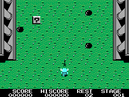
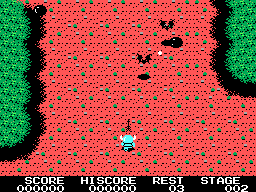

# KNIGHTMARE_COCO3

Adaptação não oficial de Knightmare do MSX para **CoCo 3 de 128 KiB**, em Assembly 6809. Versão **v0.3.0**: duas fases jogáveis e nova variante para **Tandy Speech/Sound Cartridge original, sem modificação**. Música e efeitos usam o AY do cartucho. [Instruções SSC e limitações](docs/SSC.md).

## Manual ilustrado

[Manual em PDF](docs/manual/KNIGHTMARE_COCO3_Manual_v0.2.1.pdf) · [Ler no GitHub](docs/manual/MANUAL.md)

Doze páginas com história, capturas autênticas, teclas, armas, habilidades, fases, chefes e dicas. Algumas cenas usam preparação controlada ou proteção de teste para documentação.

## Executar

Extraia o pacote de jogo v0.3.0 em uma pasta nova. DAC6/Orchestra-90: execute `EXECUTAR-DAC6.cmd` ou `EXECUTAR-ORCH90.cmd`, com Python e XRoar instalado. SSC: use `EXECUTAR-SSC.cmd --mame C:\caminho\mame.exe --rompath C:\caminho\roms`, com MAME compatível. Os scripts montam os dois discos.

| Unidade | Disco |
| --- | --- |
| Drive 0 | `bin/DAC6.DSK`, `bin/ORCH90.DSK` ou `bin/SSC.DSK` |
| Drive 1 | `bin/LEVELS.DSK` |

Na configuração manual, use CoCo 3 de 128 KiB, RGB, os dois discos e `RUN"START"`. As ROMs de sistema são fornecidas pelo usuário. Consulte [LEIA-ME.md](LEIA-ME.md).

| Tecla | Ação |
| --- | --- |
| Setas ou WASD | Mover |
| Espaço ou botão do joystick | Iniciar e disparar |
| K | Teclado |
| J / L | Joystick direito / esquerdo |
| P | Pausar |
| M | Música opcional com cinco inimigos comuns em vez de sete |
| I | Proteção de teste com borda azul |
| R | Nova partida na primeira fase |

## Esta versão

- Fases 1 e 2 com ondas, itens, armas, habilidades, chefes e checkpoints.
- Caminhada automática pela passagem após o primeiro chefe.
- Áudio DAC6, Orchestra-90 CC ou Tandy Speech/Sound Cartridge, com música opcional e efeitos.
- Restauração rápida e retenção de quadros parados. Nos testes carregados, o processamento caiu cerca de 9% e o intervalo de apagamento do jogador cerca de 10%.
- Manual, fontes, recursos, relatórios, ferramentas e pacotes históricos.

A campanha termina após o segundo chefe e retorna à abertura. Fases 3 a 8 ainda pendentes. Som, paleta e morte do segundo chefe têm adaptações; pode haver lentidão e cintilação residual. DAC6/Orchestra-90 foram testados no XRoar; SSC no MAME 0.289. Sem validação em hardware físico.

**SSC original: CPU a 0,895 MHz e menor fluidez.** Nos trechos medidos com música, aproximadamente 15–19 atualizações/s. M mantém cinco inimigos comuns; sem música, sete. O transporte sequencial pelo microcontrolador pode combinar mudanças rápidas. As quatro músicas, seis efeitos e leituras completas de tiles das duas fases foram conferidos. Os discos DAC6 e Orchestra-90 continuam idênticos aos da v0.2.1. O PDF v0.2.1 continua como manual da campanha e é acompanhado pelo suplemento SSC.

## Organização

| Diretório | Conteúdo |
| --- | --- |
| `src/` | Motor e dados Assembly 6809 |
| `assets/` e `bin/` | Recursos e discos compilados |
| `tools/` | Preparação, compilação, testes e empacotamento |
| `analysis/` e `reference/` | Relatórios, capturas e referência Z80 |
| `docs/manual/` | PDF, texto e imagens do manual |
| `research/` | Scripts e sementes REA e Ghidra |
| `archive/` | Pacotes anteriores, identificados pelos nomes originais |
| `release/` | Anexos de publicação gerados localmente |

Para jogar, use os discos atuais de `bin/` ou o pacote v0.3.0. Os ZIPs em `archive/` são históricos.

## Compilar e reproduzir

Com os recursos incluídos: `python tools/build.py --lwasm CAMINHO_DO_LWASM`.

Regeneração e testes: [FASE-2-E-SAIDA.md](analysis/FASE-2-E-SAIDA.md). Revisão gráfica: [CINTILACAO-DUAS-FASES.md](analysis/CINTILACAO-DUAS-FASES.md). Empacotamento: `python tools/package_release.py`.

O manual é gerado por `tools/build_manual.py` com ReportLab, Pillow e as fontes Arial do Windows. As capturas necessárias já estão incluídas.

## Publicação

Repositório: [benicasa2/KNIGHTMARE_COCO3](https://github.com/benicasa2/KNIGHTMARE_COCO3). Pacotes da [Release v0.3.0](https://github.com/benicasa2/KNIGHTMARE_COCO3/releases/tag/v0.3.0). Consulte [PUBLICACAO.md](PUBLICACAO.md) para reproduzir o procedimento de publicação.

## Créditos

Knightmare original: Konami, 1986. Pesquisa com [REA-RETRO-9](https://github.com/benicasa2/REA-RETRO-9), Ghidra e o disassembly comentado referenciado no projeto; compilação LWASM e testes XRoar. Licenças externas em `third_party/`. Os direitos do jogo original não são transferidos pelas licenças das ferramentas. ROMs originais e ROMs de sistema não estão incluídas.
