# Knightmare no CoCo 3

Manual ilustrado do jogador | v0.2.1

## Knightmare no CoCo 3

<b>Uma aventura de Popolon em Assembly 6809.</b> História, primeiros passos, armas, habilidades e dicas para explorar as duas fases desta versão.

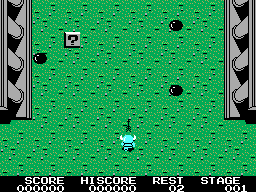

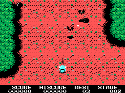

Este manual acompanha a edição com menos cintilação, para <b>CoCo 3 com 128 KiB</b>. Há duas opções de áudio: DAC de 6 bits e Orchestra-90 CC. Os comandos e as regras descritos aqui correspondem ao port atual.

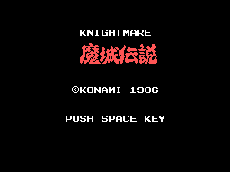

O título conserva a apresentação do Knightmare original.

<b>Comece por aqui</b>  História na página 2; instalação na 3; teclas na 4; combate na 5; armas e poderes nas 6 e 7; fases e chefes nas 8 a 10; dicas e consulta nas 11 e 12.

Projeto de adaptação não oficial. Knightmare e seus elementos originais pertencem aos respectivos titulares. Imagens obtidas do jogo e de seus próprios sprites; não são ilustrações geradas por IA.

## A busca de Popolon

Aphrodite está prisioneira no castelo do mundo das trevas. Popolon parte em sua busca, mas ainda não conhece o caminho. Em um sonho, Hera revela a direção da montanha sagrada e o incentiva a aproveitar os cristais e as joias mágicas que encontrará. Ao despertar, o cavaleiro retoma a jornada. <i>Este é um resumo livre do enredo do manual original.</i>

Popolon avança pela estrada enquanto as primeiras criaturas se aproximam.

Uma estrada que não espera

No jogo, a história se transforma em movimento: a paisagem desce continuamente e os inimigos tentam fechar os espaços livres. Cada cristal exige uma escolha. Cada chefe guarda o caminho para o trecho seguinte.

Nesta adaptação, você já pode atravessar as <b>fases 1 e 2</b>. O objetivo desta edição é vencer seus guardiões e concluir a caminhada de saída. O resgate final da campanha original ainda depende da integração das fases seguintes.

A narrativa acima resume a apresentação do manual Konami de 1986. As orientações de jogo deste livreto descrevem o código atual do CoCo 3.

## Preparar e iniciar

Extraia o pacote em uma <b>pasta nova</b>. No computador, execute <b>EXECUTAR-DAC6.cmd</b> ou <b>EXECUTAR-ORCH90.cmd</b>. Os scripts usam Python e uma instalação existente do XRoar e montam os dois discos automaticamente.

| Unidade | Disco que deve permanecer montado |
| --- | --- |
| Drive 0 | DAC6.DSK ou ORCH90.DSK |
| Drive 1 | LEVELS.DSK |

Em configuração manual, selecione <b>CoCo 3 de 128 KiB</b>, saída RGB e controlador de disco. Monte os dois discos antes de digitar <b>RUN"START"</b>. O carregamento inicial pode levar alguns instantes.

Pressione <b>Espaço</b> para pular a abertura e novamente para começar no título. A primeira partida inicia com três vidas, música desligada e proteção de teste desligada.

As ROMs de sistema <b>coco3.rom</b> e <b>disk11.rom</b> devem estar ao lado do XRoar. Elas não acompanham o projeto. Para Orchestra-90 no emulador, os scripts configuram Multi-Pak, áudio no slot 0 e disco no slot 3.

Se precisar indicar outra instalação: python tools/run_demo.py --variant DAC6 --xroar C:\caminho\xroar.exe. Troque DAC6 por ORCH90 para a outra versão.

## As teclas da aventura

Use as setas ou W A S D. Duas direções ao mesmo tempo permitem movimento diagonal. O disparo acompanha a direção da arma; a posição do personagem é que define a linha de ataque.

Movimento: W cima, A esquerda, S baixo, D direita. As setas também funcionam.

| Tecla ou controle | Função |
| --- | --- |
| Setas ou W A S D | Mover Popolon em oito direções |
| Espaço ou botão do joystick | Pular abertura, iniciar e disparar |
| K | Selecionar teclado |
| J | Selecionar joystick analógico direito |
| L | Selecionar joystick analógico esquerdo |
| P | Pausar e continuar |
| M | Ligar ou desligar a música |
| I | Alternar invencibilidade de teste |
| R | Reiniciar uma partida na fase 1 |

<b>Segure Espaço</b> para disparar continuamente. Com o joystick, pressione J ou L para escolher a porta correspondente; o teclado permanece disponível.

<b>R reinicia a partida</b> e desliga música e proteção de teste. A tecla I existe para experimentação: quando ativa, a borda fica azul. Ela não é um item coletado durante a aventura.

## Ler o campo de batalha

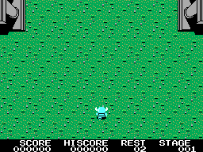

A tela de jogo tem uma área de ação e o placar na faixa inferior.

| Indicação | Como interpretar |
| --- | --- |
| SCORE | Pontos da partida atual |
| HI SCORE | Melhor pontuação conservada nesta sessão |
| REST | Vidas de reserva além do personagem atual |
| STAGE | Número da fase em andamento |

Procure uma faixa de fuga antes de se aproximar de um grupo. Os disparos inimigos e o contato com os corpos podem custar uma vida. O cenário também limita os deslocamentos; insistir contra uma borda não abre espaço.

Quando Popolon perde uma vida, o jogo retoma o início do <b>trecho de 192 pixels</b> correspondente. Arma, velocidade e habilidades são reiniciadas. A pontuação e as vidas restantes são preservadas.

Ao perder todas as vidas, o jogo volta à abertura azul KONAMI. A partida seguinte pode ser iniciada novamente pelo título. O recorde da sessão permanece enquanto o programa continua carregado.

## Cristais e armas

Os tokens flutuantes aparecem em posições previstas pelo roteiro da fase. <b>Atingi-los muda sua seleção.</b> Observe o símbolo antes de encostar neles: o disparo escolhe o prêmio e o contato o recolhe.

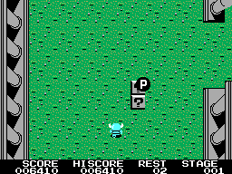

O token está em seleção durante uma demonstração de coleta.

As famílias de armas incluem flechas, lâminas, bumerangue, ataque em três direções e flecha de fogo. O motor mantém <b>doze formas de armamento</b>, combinando as versões básicas e reforçadas.

Recolher novamente uma arma da mesma família pode elevar sua forma. O bumerangue tem uma trajetória de retorno; acompanhe seu espaço de ataque. O disparo em três direções ajuda a cobrir inimigos que vêm pelos lados.

As seleções de bônus dão pontos em vez de uma arma nova. Não dispare sem olhar quando um token já mostra o prêmio que você deseja: outro acerto pode mudar a escolha.

## Habilidades e joias

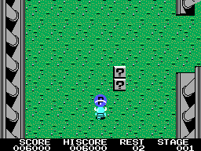

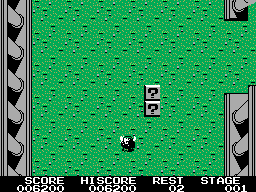

| Recompensa | Efeito nesta versão |
| --- | --- |
| Velocidade | Aumenta o deslocamento até quatro níveis |
| Escudo | Absorve tiros frontais; possui resistência limitada |
| Transparência | Proteção temporária contra contato e projéteis |
| Explosão de contato | Destrói inimigos ao encostar; impede o disparo enquanto ativa |

O escudo começa com <b>30 unidades de resistência</b>. Ataques mais fortes podem consumir mais de uma unidade. Por isso, continue desviando mesmo protegido.

As habilidades temporárias terminam sozinhas. Se havia um escudo conservado, ele pode voltar depois do efeito. O poder de contato é útil para atravessar uma formação, mas você fica sem atirar durante sua duração.

Prêmios escondidos

Alguns blocos revelam recompensas ao serem atingidos. Há bônus, vida, bomba e congelamento. <b>Congelar não torna os inimigos inofensivos:</b> mantenha distância dos corpos parados.

Itens, pontes e obstáculos dependem do roteiro de cada fase. Nem todo objeto demonstrado pelos testes aparece naturalmente em ambas as fases. A tecla I é uma ferramenta de teste separada desses poderes.

## A estrada e o guardião

As formações entram em momentos definidos pelo roteiro.

Aprenda a cadência das entradas antes de correr para o alto da tela. Movimentos curtos costumam deixar mais opções de fuga do que atravessar a estrada inteira. Use os tokens para chegar ao final com um armamento conhecido.

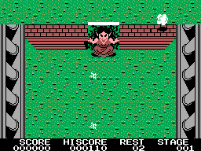

O primeiro guardião e seus satélites protegem a passagem.

O primeiro chefe começa com <b>20 pontos de vida</b> e possui três satélites. Observe o deslocamento do corpo e o caminho dos acompanhantes. Atire quando a linha estiver livre e reserve uma lateral para escapar.

Evite subir para dentro do corpo do chefe. No trecho final, perder uma vida preserva o estado do combate conforme o checkpoint; o equipamento do jogador continua sendo perdido.

## A caminhada pela passagem

Depois da derrota do primeiro guardião, o controle da caminhada passa ao jogo. Popolon se alinha à passagem central, avança e sai pela parte superior. Você não precisa manter uma tecla de direção pressionada.

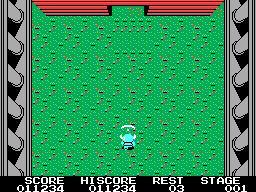

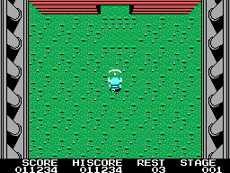

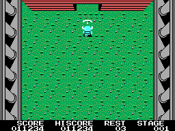

A sequência é executada pelo código 6809 do port, com trajetória e animação comparadas à rotina original do MSX. As três imagens mostram momentos reais da mesma saída.

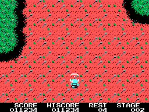

A chegada à fase 2 conserva o equipamento e a pontuação.

Ao entrar na segunda fase, a pontuação, as armas e as habilidades são mantidas, e o jogador recebe <b>uma vida adicional</b>. O disco de cenários é lido nesse intervalo: deixe <b>LEVELS.DSK no drive 1</b>.

Não pressione R para continuar: essa tecla cria uma partida nova na fase 1. Basta aguardar a conclusão da caminhada e do carregamento.

## A trilha vermelha

A segunda fase troca o cenário e amplia os padrões de ataque.

A nova estrada traz investidas, cruzamentos e inimigos que mudam de comportamento ao receber dano. Um dos tipos resiste a quatro impactos e passa por uma animação de expansão e recuperação. Não confunda essa reação com uma eliminação imediata.

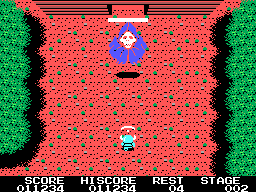

O segundo guardião lança peças com movimento próprio.

O segundo chefe começa com <b>30 pontos de vida</b>. Seu corpo se desloca continuamente e ele lança peças que também precisam ser acompanhadas. Desvie pensando no movimento seguinte, não apenas na posição atual do chefe.

Depois da vitória e da caminhada final, esta edição volta à abertura KONAMI. <b>As fases 3 a 8 ainda não estão integradas à campanha jogável.</b> O visualizador de oito mapas é uma ferramenta separada.

## Sobreviver por mais tempo

Silhuetas dos inimigos

Durante o caminho

<b>Guarde uma saída.</b> Evite ficar entre um inimigo e a borda. Quando um grupo entra, observe de qual lado sobra espaço antes de disparar e avançar.

<b>Troque distância por tempo.</b> Ficar mais abaixo permite acompanhar a trajetória de alguns projéteis. Subir demais reduz o tempo para reagir aos nascimentos.

<b>Escolha o token.</b> Pare de atirar quando o símbolo desejado aparecer e aproxime-se por uma linha segura. O prêmio errado pode trocar sua arma atual.

Nos chefes e nos retornos

<b>Conheça o alcance.</b> Flechas, bumerangue e ataque espalhado ocupam áreas diferentes. A melhor posição depende do armamento que você realmente tem.

<b>Recomece o trecho com calma.</b> Depois de morrer, o equipamento é reiniciado. Reavalie a velocidade e a arma antes de repetir um movimento que dependia de um poder perdido.

<b>Use o teste para estudar.</b> I permite observar trajetórias com proteção. Ao voltar à partida normal, desligue o modo e confirme a borda sem o indicador azul.

Os sprites acima são imagens reais dos recursos do jogo. Eles ajudam a reconhecer silhuetas e não indicam a ordem exata de aparecimento das formações.

## Áudio e informações finais

| Opção | O que muda |
| --- | --- |
| DAC6 | Efeitos e música pelo DAC de 6 bits do CoCo |
| Orchestra-90 CC | Mistura mono enviada aos dois canais do cartucho |
| Música desligada | Efeitos ativos e até sete inimigos comuns |
| Música ligada com M | Até cinco inimigos comuns; chefes preservados |

A música começa desligada. M alterna as faixas da fase e do chefe nas duas etapas jogáveis. Com música, o limite de inimigos comuns cai de sete para cinco, uma redução de aproximadamente 29%.

A revisão de desenho reduz cópias e evita apagar quadros sem mudanças. Ela foi mais rápida nos cenários medidos, mas ainda pode haver lentidão e cintilação residual em situações carregadas. O piscar intencional após dano foi mantido.

O que esta edição entrega

Duas fases, dois chefes, controles por teclado e joystick, armas, habilidades, checkpoints, caminhada automática e reinício pela abertura KONAMI. Som de duas vozes, paleta RGB e morte do segundo chefe ainda têm adaptações. Os testes foram feitos no XRoar com 128 KiB; não houve teste em hardware físico.

Créditos e referências

Jogo original: <b>Knightmare</b>, Konami, 1986. Adaptação e documentação deste projeto: reengenharia do MSX para CoCo 3, preparada para o repositório <b>benicasa2/KNIGHTMARE_COCO3</b>.

Enredo: manual original Konami, preservado em [Knightmare How to play](https://manuals.plus/m/e0b612d28cc1ab4fc591a86587b876cd3f2fae274e11ebab61bfd5c6e69275a2). Ferramentas e pesquisa: [REA RETRO 9](https://github.com/benicasa2/REA-RETRO-9), Ghidra, LWASM e XRoar. As licenças dos componentes externos estão em third_party.

As capturas foram obtidas na versão DAC6 do port. Algumas cenas usam preparação controlada ou proteção I para documentação, sem alterar a arte renderizada. As instruções também valem para Orchestra-90. ROMs originais e ROMs de sistema não são distribuídas.

Consulta técnica: LEIA-ME.md, STATUS.json, analysis/FASE-2-E-SAIDA.md e analysis/CINTILACAO-DUAS-FASES.md. A pontuação desta edição satura em 65.535; não suponha que todas as regras de pontuação do cartucho original já estejam reproduzidas.
